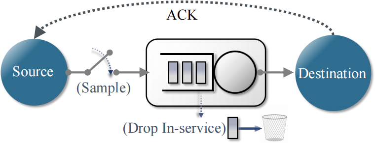
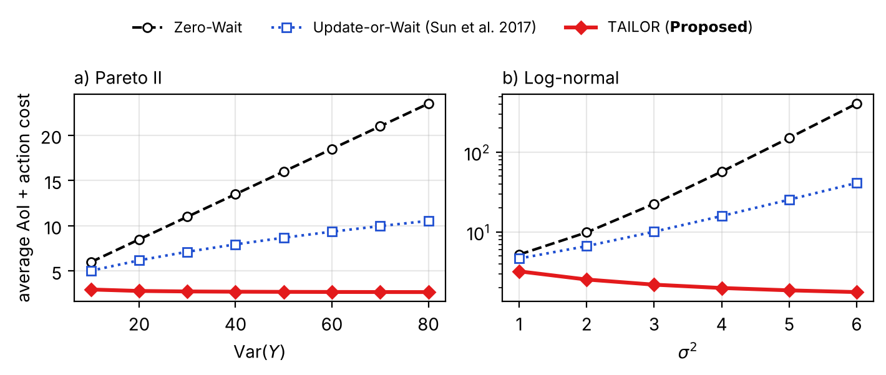

# TAILOR: Age-Optimal Preemption under Heavy-Tailed Delays

[](https://doi.org/10.1109/ISIT62367.2026.11653616)
[](https://arxiv.org/abs/2601.16624)
[](https://colab.research.google.com/github/AiminLi-Hi/aoi-preemption-heavy-tail/blob/main/python/examples/quickstart.ipynb)
[](https://yigiti.github.io/Preemption/)
[](LICENSE)

Official code for **“Taming the Heavy Tail: Age-Optimal Preemption”** by Aimin Li, Yiğit İnce, and Elif Uysal, *IEEE ISIT 2026*.

**When should a sensor sample a fresh update, and when should it abandon an update stuck in a slow channel?**
TAILOR answers both questions jointly for *any* service-time distribution with a finite second moment, and is built to stay fast and accurate when delays are heavy-tailed (Pareto, log-normal).



## Key insight: variability becomes an advantage

Without preemption, delay variability hurts information freshness. With optimal preemption, it helps: short services are exploited, while long ones are cut off by a state-dependent preemption rule. As the variance grows, TAILOR's cost *decreases* while the best non-preemptive policy degrades by more than an order of magnitude.



*Average AoI + action cost with E[Y] = 2 and κ<sub>s</sub> = κ<sub>p</sub> = 1. TAILOR uses the ACOE optimum; baseline costs are computed exactly by renewal-reward analysis. Reproduce with [`python/examples/reproduce_fig2.py`](python/examples/reproduce_fig2.py).*

## Install and use in three lines (Python)

```bash
pip install "tailor-aoi[plot] @ git+https://github.com/AiminLi-Hi/aoi-preemption-heavy-tail.git#subdirectory=python"
```

```python
from tailor_aoi import ServiceDist, solve, compare

dist = ServiceDist.lognormal_from_mean(mean=2.0, sigma2=6.0)   # or pareto2, exponential, from_scipy(...)
policy = solve(dist, kappa_s=1.0, kappa_p=1.0)                  # optimal sampling + preemption policy
print(compare(dist, 1.0, 1.0, policy=policy))                   # TAILOR vs. Update-or-Wait, Zero-Wait, best static
```

`policy.sampling_target(delta)` gives the AoI level z\*(Δ) at which to sample, and `policy.preemption_time(y)` gives the time θ\*(y) after which an unfinished update is preempted. From the command line:

```bash
python -m tailor_aoi --dist pareto2 --mean 2 --var 40 --ks 1 --kp 1
```

### What the package provides

| Module | Content |
|---|---|
| `solve` | TAILOR: average-cost policy iteration on the integral ACOEs (Theorem 1), hybrid action grid and far-field linear closure for heavy tails |
| `ServiceDist` | Pareto II (Lomax), log-normal, exponential, or any `scipy.stats` distribution |
| `zero_wait`, `update_or_wait`, `optimized_static`, `static_cost` | Baselines with **exact** average costs (renewal-reward), immune to heavy-tail Monte Carlo bias |
| `simulate`, `sample_path` | SMDP-consistent Monte Carlo with time-average cost and the 99% AoI quantile |
| `plotting` | Policy maps θ\*(y), z\*(Δ) and AoI sample paths |

The test suite (`pytest python/tests`) checks the solver against the closed form of Theorem 2 (exponential delays, optimum 1 + √2 for κ<sub>s</sub> = κ<sub>p</sub> = 1), the exact baselines against simulation, and the paper's log-normal result (TAILOR cost 1.76 at σ² = 6).

## MATLAB code (paper version)

`Paretov2.m` solves the ACOEs for Pareto II (Lomax) service times and compares TAILOR with the optimized static, AoI-optimal Update-or-Wait, and Zero-Wait policies under common random numbers. Keep the default parameters for reproducibility.

## Citation

If you use this code or build on TAILOR, please cite:

```bibtex
@inproceedings{li2026taming,
  title     = {Taming the Heavy Tail: Age-Optimal Preemption},
  author    = {Li, Aimin and {\.I}nce, Yi{\u{g}}it and Uysal, Elif},
  booktitle = {Proc. IEEE International Symposium on Information Theory (ISIT)},
  year      = {2026},
  doi       = {10.1109/ISIT62367.2026.11653616}
}
```

GitHub's **“Cite this repository”** button (right sidebar) gives the same entry in BibTeX and APA, and `python -m tailor_aoi --cite` prints it.

## Contact

Questions, issues, and extensions (e.g., other delay models or constraints) are welcome via GitHub Issues or email: hitliaimin@163.com.

## License

MIT. See [LICENSE](LICENSE).
