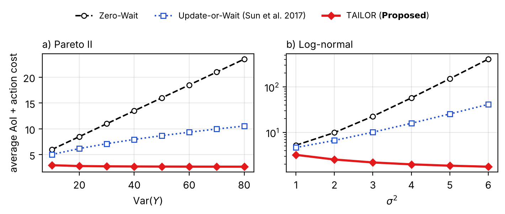

# tailor-aoi

Python implementation of **TAILOR**, the age-optimal joint sampling and preemption policy from
*Taming the Heavy Tail: Age-Optimal Preemption* (A. Li, Y. İnce, E. Uysal, IEEE ISIT 2026,
[DOI 10.1109/ISIT62367.2026.11653616](https://doi.org/10.1109/ISIT62367.2026.11653616)).



## Install

```bash
pip install tailor-aoi            # core
pip install "tailor-aoi[plot]"    # with matplotlib helpers
```

## Use

```python
from tailor_aoi import ServiceDist, solve, compare

dist = ServiceDist.pareto2(mean=2.0, variance=40.0)   # or lognormal_from_mean, exponential, from_scipy
policy = solve(dist, kappa_s=1.0, kappa_p=1.0)        # optimal sampling + preemption policy
print(compare(dist, 1.0, 1.0, policy=policy))         # vs. Update-or-Wait, Zero-Wait, best static
```

Command line: `python -m tailor_aoi --dist lognormal --mean 2 --sigma2 6`.

- Repository and MATLAB code: https://github.com/AiminLi-Hi/aoi-preemption-heavy-tail
- Colab quickstart: https://colab.research.google.com/github/AiminLi-Hi/aoi-preemption-heavy-tail/blob/main/python/examples/quickstart.ipynb
- Project page: https://yigiti.github.io/Preemption/

## Citation

If you use this package, please cite the paper (`python -m tailor_aoi --cite` prints the BibTeX):

```bibtex
@inproceedings{li2026taming,
  title     = {Taming the Heavy Tail: Age-Optimal Preemption},
  author    = {Li, Aimin and {\.I}nce, Yi{\u{g}}it and Uysal, Elif},
  booktitle = {Proc. IEEE International Symposium on Information Theory (ISIT)},
  year      = {2026},
  doi       = {10.1109/ISIT62367.2026.11653616}
}
```
